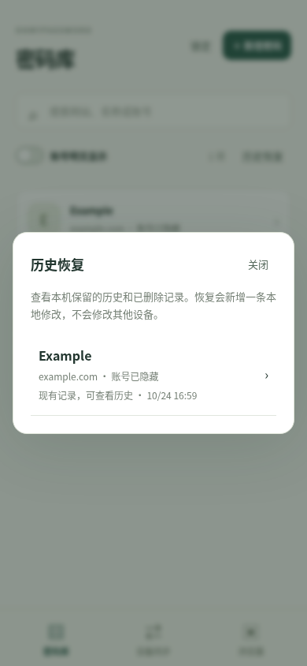

# 密码历史与恢复

如果旧版合并后密码列表变空，先停止再次合并，保留两台设备的应用和数据。列表为空不一定表示所有历史已经消失；能否恢复，取决于原加密库中是否仍有非删除版本，或是否保留完整旧副本与对应主密码。

## 先保留原文件

对于「Mac 原来有密码，小米发起合并」的情况，先保护 Mac 上的原库，同时保留小米上的原安装。

1. 不要再合并、删除记录、创建替代密码库或清理应用数据。不要为安装新 APK 卸载小米上的旧应用。
2. 在 Mac 访达中选择「前往 → 前往文件夹」，输入：

   ```text
   ~/Library/Application Support/com.ecojust.ohmypassword
   ```

3. 将整个 `com.ecojust.ohmypassword` 文件夹复制到自己控制的另一处存储，使用新的文件夹名。只复制，不移动、重命名原目录或覆盖现有副本。至少要保留原始 `vault.json` 和对应的 `identity.json`；如果已有 `backups`，一并复制。
4. 保留当前应用版本与事故前后操作记录。不要把主密码、密码库文件、截图中的账号密码公开上传到 Issue 或聊天中。

`vault.json` 是加密内容，不能直接用文本编辑器修改、清空或拼接。`identity.json` 必须和同一份库配套保留。原主密码仍是解锁恢复数据的必要条件，软件无法绕过它。

## 在 0.2.3 中恢复本机历史

0.2.3 继续使用原加密密码库格式。Mac 先完成上述原目录备份，再退出旧应用并替换应用程序；保留原数据目录，更新后使用原主密码解锁。更新应用不需要新建密码库。首次启动若意外显示「创建密码库」，先停止，不要创建，检查原数据目录和应用标识是否正确。

1. 点击「密码库」列表上方的 **「历史恢复」**。即使当前列表没有任何密码，入口也存在。
2. 选择要找回的条目。列表显示「已删除，可恢复」或「现有记录，可查看历史」；单个当前有效版本也可以查看。
3. 按时间查看本机保留的版本。密码默认隐藏，可按需显示核对。
4. 点击目标版本的 **「恢复此版本」**，再点击 **「确认恢复到本机」**。
5. 恢复前会保存一份当前库的独立加密备份，然后将选中版本保存为新的本地修改；原历史不会移除，其他设备不会改变。完成后检查网站、账号和密码是否符合预期，再处理下一条。
6. 先确认 Mac 上需要的密码全部找回并保留备份，再处理手机更新与接收。小米不能直接覆盖安装开发 APK 时，仍应保留旧应用；不要把卸载作为找回密码的步骤。



只导入较旧的有效版本不会覆盖本机较新的删除标记，因此某些条目可能已经存在于历史中、但仍不出现在密码列表。此时需要上述明确的恢复操作。若「历史恢复」没有任何可恢复条目，请保留原文件并检查其他旧副本或系统备份，不要反复合并来尝试“刷新”出密码。

## 新版的单向接收

两台设备均使用 0.2.3 或兼容的协议 3 客户端后，在**需要取得密码的设备**上选择来源，点击「接收对方密码」。例如小米向 Mac 请求，只有小米导入 Mac 的当前有效密码；Mac 不接收小米数据，也不会因小米为空而修改或删除密码。

两端仍需核对会话编号并确认。仅传当前有效记录，不传删除标记或完整历史；空来源或来源缺少记录不会删除本机已有记录。相同 ID 的有效修订按修改版本比较，保留本地较新的内容。旧协议 2 的双向设备不会与新版继续合并，必须先更新兼容客户端。本机浏览器接口的协议 2 不受影响。

## 自动加密备份

0.2.3 在有变更的接收、以及历史恢复写入前，保存操作前的加密密码库与设备标识。Mac 上的位置为：

```text
~/Library/Application Support/com.ecojust.ohmypassword/backups/
  before-pull-时间-UUID/
    vault.json
    identity.json
  before-restore-时间-UUID/
    vault.json
    identity.json
```

备份名中的时间是 UTC 毫秒时间戳；每次使用独立目录，不覆盖早先副本。Unix 系统的备份目录权限为 `0700`，文件为 `0600`。这些仍是敏感文件，应保存在自己控制的存储中。

备份目录最多容纳 64 个目录项。达到上限时，新的有变更接收或恢复会明确失败，原库不变；先将旧备份复制到另一处并确认副本完整，再归档原目录中的相应备份。程序不会自动删除最早的副本。普通新增、编辑或删除保留条目修订历史，但不会每次生成整库备份。

整库恢复会回到备份时的状态，不会自动保留之后的修改。优先使用应用内的条目历史恢复。确需从整库备份恢复时，先退出应用，并将当前整个数据目录另存一份；再从**同一份备份**取出 `vault.json` 与 `identity.json` 成对恢复到原数据目录，用备份时的主密码解锁。不要混用来自不同设备或不同备份的文件，也不要在应用运行时替换文件。

## 已知与未知

旧版 0.2.2 的双向合并会传播删除标记。独立测试中，一个可见列表为空、但仍含对应删除标记的设备发起合并，会让另一台设备的相应记录也从列表消失；两边非删除历史仍保留，可用于恢复。

真正新建、没有任何修订的空库在当前隔离复现中没有清空提供方。这个结果不能证明用户现场属于删除传播，也不能排除其他问题；现场具体原因仍需要保留原数据后核对。界面搜索条件、锁定状态和读取错误也应与磁盘数据损失区分。

旧版没有自动整库备份。如果原历史已不存在、应用被卸载清除了数据，或密码库已重建且没有任何旧副本，不能凭空找回旧密码。0.2.3 的备份只能保护之后的操作，不能补造事故前的文件。所有恢复结果都应由用户在本机核对，不需要向维护者提供主密码或真实密码内容。
