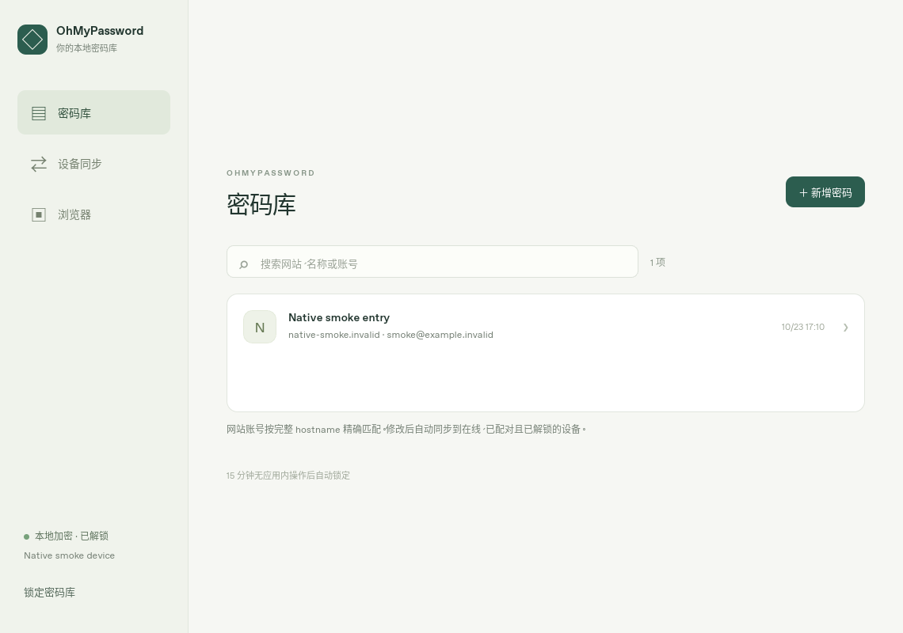

# 验证记录

## 0.2.1 主域名匹配

应用源码为 `ea152f4`；[完整 CI 40071390606](https://github.com/ecojust/OhMyPassword/actions/runs/40071390606) 六个任务于 2026-10-24 全部成功。核心 21 项、服务 15 项、插件 22 项、共享界面 17 项，共 75 项自动化测试通过，另有真实 Chromium 扩展验证。

- 核心 21 项测试、服务 15 项测试、插件 22 项 Node 测试本地通过。
- Rust `psl 2.1.243` 与 JavaScript `tldts 7.4.19` 对应同一组 PSL 规则（2026-10-17 的 `52b71b3c` 快照），包含 ICANN 与 PRIVATE；两端读取相同的 49 条 hostname/预期匹配域样例。插件额外校验样例间全部配对关系，覆盖多级后缀、托管租户、通配/例外、IDNA、IP、本地名、未知及非法 hostname。
- 新增真实 HTTP 查询覆盖根域/兄弟子域、`co.uk`、`github.io` 租户隔离、IPv4/IPv6/localhost 精确匹配、裸公共后缀不枚举账号，以及原 Origin 和锁定限制。
- 插件测试验证同主域账号可用、保存更新保留原完整 hostname 与 ID、新账号保存当前完整 hostname；填充前及注入时仍精确检查页面，兄弟子域跳转不会继续填充。
- 查询只计算匹配键，不改写记录或密码库；核心测试确认原 hostname、ID 和磁盘密文未因查找而改变。

真实浏览器扩展测试使用本地拦截的 HTTPS 页面和虚构账号，检查打包后的域名模块、真实查询/保存请求、保留原网站，以及跨域/独立租户拒绝。现有 loopback 页面继续验证真实 `scripting` 注入、主框架限制、Origin 和锁定。测试未扩展生产插件权限，也未模拟 HTTPS 页面的 activeTab 授权，因此不将该部分报告为 HTTPS 实际注入验证。

五个平台和浏览器插件全部打包成功；macOS 完整签名与安装启动、Android APK v2 签名及 iOS 模拟器配置检查通过。实际包大小见 README；本轮 APK 为 **15,135,687 bytes（14.435 MiB）**。Android 签名证书 SHA256 为 `179a80b35daaeb190c1c2698fe0f04c1161468103092c130176ecaa320ccaf65`，与 0.2.0 及 0.1.0 均不同，不能直接覆盖安装。原应用与密码数据应保留至确认已有完整、可恢复的副本。

## 0.2.0 验证

[完整 CI 40068112846](https://github.com/ecojust/OhMyPassword/actions/runs/40068112846) 六个任务全部通过，应用源码提交为 `88e54ff`（2026-10-24）。

- 插件：16 项 Node 测试通过，覆盖默认免令牌连接、旧令牌清理、固定扩展身份、无 Authorization 请求头及原有填充保护。
- 真实 Chromium 扩展：固定扩展 ID、免令牌连接与 POST 查询、填充、更新保留 ID、跳转拒绝和锁定访问保护通过。
- 共享界面：17 项场景通过，覆盖自动/手动检测展示、双端确认、实际完成后提示「已合并密码本」、拒绝/失败/过期、刷新失败及锁定后的迟到回复。
- 核心：17 项测试通过，包含原有加密、最新修改合并、删除、容量与持久化检查；新增 3 项临时写入保护测试覆盖最终确认期间拒绝修改、删除和外部合并，错误会话不能释放保护，以及锁定和重新启动后的清理。
- 服务：14 项回归通过，包含真实双端 HTTP 人工确认合并、未确认不交换数据、检测与保存不自动合并、拒绝/锁定/过期、容量保护、握手篡改，以及故意丢失两次最终 ACK 后按加密回执恢复完成状态。
- 原生入口：桌面与移动 wrapper 的 `cargo check --release --locked` 通过。
- 平台包：Windows x64 安装器与便携 EXE、macOS ARM64 DMG、Linux x64 DEB、Android ARM64 APK、iOS ARM64 Simulator App ZIP 均构建并校验通过。macOS 验证签名及安装启动；Android 日志确认为 `dev profile [optimized]`，APK v2 签名通过。

Linux 另用实际 Release 原生窗口验证建库、保存、锁定、解锁、退出重启后的持久化，并通过同一进程的真实 HTTP 接口验证：官方扩展 Origin 无令牌读写成功、HTTP 新增可在原生界面显示、未知扩展/普通网页/缺少 Origin 的凭据访问被拒绝、锁定返回 423。磁盘密码库不含测试凭据明文，权限为 `0600`，应用日志为空。

升级读取检查使用独立复制的 0.1.0 测试 profile：0.2.0 识别已有加密库，原主密码可解锁并正确读取条目；退出后源文件和副本的密文 SHA256 均未改变，无需重写或迁移。以上原生检查只用虚构 `.invalid` 测试数据，没有修改真实密码库或请求其他设备合并。

Android 包为 **14,222,847 bytes（13.564 MiB）**。已比对签名证书 SHA256：0.1.0 为 `7bce33b483f77c11c353e3b5d08b716f6746bac469e367950748ac1ecb6acdac`，0.2.0 为 `25696523ef48ac71490f3108f98e8e44684d88b11baf518e00ca04f3777405c2`。证书不同，不能覆盖安装；这与加密密码库格式兼容是两个独立条件。需保留旧应用及数据，在确认已有完整可恢复副本前不能通过卸载解决安装问题。

共享界面场景使用模拟 IPC，网络服务测试使用本机独立节点；二者均不代表手机真实局域网发现和生命周期行为已验证。平台边界及待实测项见下文。

## 0.1.0 历史验证

### 功能验证

| 范围 | 结果 |
| --- | --- |
| Rust 密码库核心 | 14 项测试通过：错误主密码、加密篡改、重启、锁定、准确 hostname、授权撤销、最新修改合并、删除、乱序与重复、容量与持久化失败回滚 |
| Rust 网络服务 | 10 项测试通过：真实 HTTP 双库配对及同步、锁定、撤销竞态、Host/Origin/令牌、AEAD/重放/epoch、容量回滚、立即退出及慢请求退出 |
| 插件逻辑 | 13 项 Node 测试通过：准确网站匹配、授权存储、POST 查询契约、请求约束、流式长度限制、HTTPS 填充、防跳转与最小权限 |
| 真实 Chromium 扩展 | CI 加载真实扩展，验证连接与查询 POST 的 Origin、主页面填充、不提交表单、不填充 iframe、跳转拒绝、更新保留 ID 及锁定拒绝 |
| 共享界面 | 11 项浏览器场景通过：创建/解锁、CRUD、授权、锁定清理、过期异步回复、远端记录刷新、手机布局与服务失败时本地可用 |
| Linux 原生客户端 | Release 构建及 DEB 打包通过；实际 WebKit/Tauri 窗口首次建库、保存、锁定、解锁与退出重启后恢复通过 |

原生验证使用独立的应用数据目录和虚构 `.invalid` 测试凭据，未连接真实用户设备。检查了实际密码库文件的 `0600` 权限与加密 envelope，确认不含测试主密码、账号、密码或 hostname 明文。应用 stdout/stderr 为空。

共享界面测试使用模拟 IPC，不能代替原生验证；核心和网络测试使用临时目录与本机独立节点，不能代替手机与电脑之间的真实局域网验证。

### 跨平台构建

[完整 CI 39995965398](https://github.com/ecojust/OhMyPassword/actions/runs/39995965398) 已全部通过，验证提交为 `21d22f9`（2026-10-23）：

- Windows x64：Release NSIS 安装器与便携 EXE。
- macOS ARM64：Release DMG、完整签名验证及安装后启动。
- Linux x64：Release DEB。
- Android ARM64：APK 构建、原生库存在检查和 APK 签名验证。
- iOS ARM64 Simulator：模拟器 App 构建、Bonjour 权限配置和产物校验。
- 核心、服务、插件逻辑、真实 Chromium 扩展及共享界面测试。

随后仅调整 Android 构建参数的 `924ec7e` 通过 [Android 专项 CI 39997614999](https://github.com/ecojust/OhMyPassword/actions/runs/39997614999)：Cargo 日志确认为 `dev profile [optimized]`，移除调试信息后 APK 为 **14,108,519 bytes（13.455 MiB）**，比原调试包减少 **91.41%**。APK v2 签名校验通过，仍使用 Android Debug 开发签名。该次未修改应用代码，其余平台与功能测试沿用上述完整验证结果。

各包实际大小和下载入口见 [README](README.md#测试包与大小)。上述构建验证不代表手机真机行为已通过测试。

真实扩展测试曾发现 Chromium 的 GET 请求不携带 Origin，因此插件已统一使用 POST 查询；修复后的真实测试已通过。本机 Chromium 的管理员策略禁止加载未打包扩展，未改动本机策略。

## 尚需真实设备验证

- Android 与 iOS 的局域网权限、NSD/Bonjour 发现、后台锁定与前台恢复。
- 不同路由器、访客网络隔离、防火墙和断网重连下的跨设备同步。
- 手机系统剪贴板行为，以及 Windows/macOS 的首次安装体验。
- 密码管理器的独立安全审计。

Android CI 包使用开发签名，iOS CI 包供模拟器使用；iPhone 真机安装需开发者签名。macOS 使用 ad-hoc 签名，尚未 Apple 公证。编译、功能测试与代码审阅不等于上述平台许可或完整安全审计。
