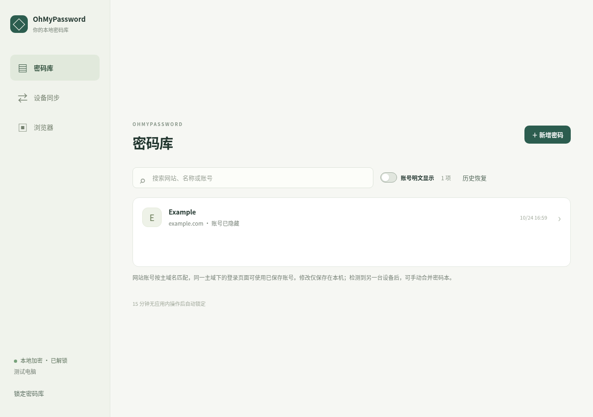

# OhMyPassword 桌面端

基于 Tauri 2、Rust 和原生 TypeScript/CSS 的本地密码管理器，支持 Windows x64、macOS Apple Silicon（macOS 11+）、Linux x64。使用系统 WebView，没有内置 Chromium、Node.js 或远程账户服务。



## 使用

1. 首次打开设置设备名称和至少 10 个字符的主密码。主密码无法找回；设备数据以 Argon2id 派生密钥、AES-256-GCM 加密保存在应用数据目录中。
2. 在「密码库」新增网站 hostname、账号和密码，点击条目编辑。默认隐藏密码，只有明确点击显示/复制才展示或复制。新增、修改和删除只保存到本机，不会自动传给其他设备。
3. 在设备页面查看局域网内的 OhMyPassword。解锁后立即检测一次，之后每 **300 秒**自动检测，也可点击「手动检测」。检测只更新设备列表，不读取或合并对方密码本。
4. 选择设备并点击「合并密码本」，这一步仅准备会话并通知对方。两端显示会话校验码（SAS）后，核对两端完全一致，再分别点击确认；发起端也必须再次确认。只有双方都确认后才执行这一次加密双向合并，无需生成、复制或填写邀请码。只有本机合并和对方确认成功后才提示 **「已合并密码本」**。之后的修改仍留在各自本机，需要再次手动合并。
5. 浏览器插件自动连接本机客户端，无需创建或粘贴额外 token。客户端必须运行且已解锁；插件根据当前网站的可注册主域名匹配密码，也可将新密码保存到本机密码本，保存不会触发局域网合并。
6. 手动锁定或 15 分钟无应用内操作后，密码 API 和正在等待的合并会话停止；解锁只恢复设备检测，不自动合并。桌面失去焦点不会锁定，方便浏览器插件使用；关闭窗口会退出进程，最小化仍运行。当前没有托盘及开机自启。

每次合并独立确认，不会因为曾经合并而给予对方永久读取权限。同一条密码以最新修改为准，旧版本可在「历史版本」查看，删除标记参与合并。合并不能远程擦除其他设备已经保存的数据。复制密码后内容仍在系统剪贴板中。浏览器预览不保存密码，只有原生客户端提供密码库操作。

## 开发与构建

先安装 Node.js 22+、Rust stable，以及对应平台的 [Tauri 系统依赖](https://v2.tauri.app/start/prerequisites/)。Linux 需要 GTK3 / WebKitGTK 4.1；Windows 使用 WebView2。

```bash
# 仓库根目录
npm ci
npm run build --workspace @ohmypassword/desktop
npm run tauri --workspace @ohmypassword/desktop -- dev
npm run tauri --workspace @ohmypassword/desktop -- build
```

`src/` 是与移动端共用的前端，`src-tauri/` 是原生壳与窄范围 IPC；`core/` 负责加密存储，`service/` 负责本机 HTTP 接口、设备检测和单次加密合并。构建只把编译后的资源嵌入应用，开发依赖不会打入安装包。Release 开启体积优化、LTO 和符号移除。

本地密码 HTTP 默认只监听 `127.0.0.1:17841`，局域网合并端口为 `17842`。浏览器接口仍校验本机 Host 和扩展 Origin，普通网页不能直接读取；免 token 的信任边界见 [SECURITY.md](../SECURITY.md)。单次合并的密钥不返回给 WebView。端口被占用时密码库仍可本地使用，网络功能会显示错误。

自动化测试覆盖密码库、HTTP 接口、浏览器插件和 UI；真机联网及各系统生命周期验证以根目录验证记录为准。macOS 构建使用 ad-hoc 签名，不代表 Developer ID 签名或 Apple 公证。
