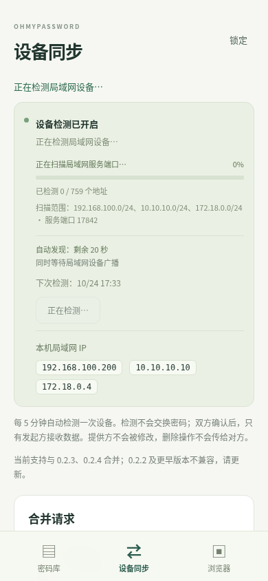
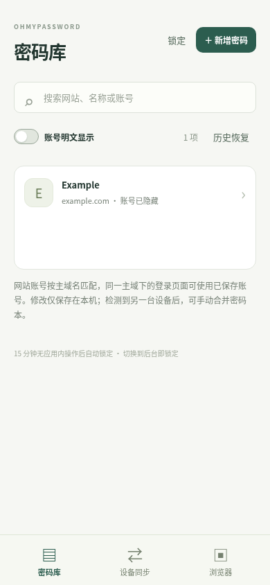

# OhMyPassword 移动端

Android 和 iOS 原生客户端，共用桌面端 Rust 加密密码库、局域网合并服务及轻量前端。创建主密码后可新增、编辑、查看、复制和删除密码；密码默认隐藏。密码库列表顶部提供「账号明文显示」开关，默认关闭；开启后显示用户名，关闭或锁定后恢复隐藏，不影响打开记录进行编辑。日常修改只保存在本机。应用每 300 秒检测局域网设备，也提供「手动检测」；检测只更新设备列表。设备页显示本机版本、局域网 IPv4 地址、主动扫描的已检测地址数/总数与百分比；自动发现另有约 20 秒倒计时。多地址自动换行，未获得地址时提示连接网络。已验证兼容 0.2.3、0.2.4，0.2.2 及之前不可合并；识别到旧版时只提示更新。





## 合并密码本

两台设备处于同一局域网、应用都在前台且密码本已解锁时，在**需要取得密码的设备**选择来源并点击「接收对方密码」。核对两端会话校验码（SAS）完全一致后，发起方确认接收到本机，提供方允许提供。两端都确认后，只有发起方导入数据；提供方不会接收或删除任何密码。无需邀请码，也不会自动记住后续权限。

发起方成功后显示 **「已合并密码本」**，提供方显示「已向对方提供密码，本机密码未修改」。仅传来源的当前有效记录，不传历史和删除标记；空来源或缺少记录不会清空本机。同一 ID 的修订以最新修改为准，已有较新本地删除需显式恢复。新增、修改、删除不会自动推送，删除只影响本机。

密码库列表上方提供「历史恢复」，当前列表为空也可查看本机保留的旧版本与已删除条目。选择「恢复此版本」并「确认恢复到本机」，会先创建加密备份，再新增本地修订；其他设备不受影响。恢复条件、Mac 优先处理步骤及手机保留事项见 [恢复说明](../RECOVERY.md)。

## 运行边界

- **Android 7.0 / API 24+、iOS 15+**。Android 使用 NSD；iOS 使用 Bonjour，首次需要允许本地网络权限。发现服务类型为 `_ohmypassword._tcp.`，发现协议为 `protocol=3`，只接收同协议设备（两台客户端都需更新到 0.2.3 或兼容版本），只广播协议版本和设备标识，不广播用户填写的设备名称、密码或合并密钥。
- 进入后台立即锁定密码库、停止发现并拒绝密码 API，取消尚未完成的合并会话；回到前台后需要重新解锁。解锁后只重新检测设备，不自动合并密码本。不会申请音频、定位、VPN等无关后台权限，也不承诺后台常驻 HTTP。
- 设备通过 IPv4 局域网通信，必须网络互通；访客网络隔离、防火墙或拒绝本地网络权限可能阻止检测和合并。每轮浏览持续约 20 秒，设备服务在前台解锁期间持续可被发现；缓存设备记录会在 660 秒未重新发现后过期，列表存在不保证设备此刻仍在线。
- Android 禁止系统备份并应用 `FLAG_SECURE`；iOS 在切到后台时遮盖应用预览。iOS 本地文件仍受系统备份策略影响，密码库文件自身始终加密。
- 首版未接入 Android Autofill / iOS Credential Provider，手机密码可在客户端查看和手动复制。复制内容会进入系统剪贴板，请留意其他应用的剪贴板权限。
- 接收只传来源当前有效的密码记录，不传历史、删除标记或本机主密码，也不创建永久配对权限。每台设备可以使用不同主密码。本机浏览器接口仍使用协议 2。

## 构建

从仓库根目录先运行 `npm ci`。Android 需要 JDK 17、Android SDK 36、NDK 27.2.12479018、Rust stable 和对应目标；iOS 必须在 macOS 安装 Xcode / Command Line Tools、Rust及 iOS 目标。

```bash
# 在仓库根目录
npm run android:init --workspace @ohmypassword/mobile
npm run android:dev --workspace @ohmypassword/mobile
npm run android:build --workspace @ohmypassword/mobile

# macOS 上运行；模拟器不需要开发者签名
npm run ios:init --workspace @ohmypassword/mobile
npm run tauri --workspace @ohmypassword/mobile -- ios build --ci --debug --target aarch64-sim --no-sign
```

`android:init` / `ios:init` 会调用 Tauri 生成平台工程，然后运行 `.github/scripts/prepare-mobile.py`：Android 固定 SDK 36，关闭系统备份和 WebView 明文网络；iOS 检查本地网络用途说明和 Bonjour 声明。生成工程位于 `src-tauri/gen/`，不作为手写代码维护。iOS 真机安装及分发需要用户自己的 Apple 开发者签名，CI 模拟器 `.app` 不能直接安装到 iPhone。

CI 的 Android 开发包会对 Rust 启用体积优化并移除调试信息，保留开发签名。本地默认调试构建包含调试信息，体积较大；复现 CI 小包的环境变量与命令见 [构建脚本说明](../.github/scripts/README.md)。

主要代码：`src-tauri/` 是移动入口，`plugins/discovery/` 是 Android NSD / iOS Bonjour 及后台预览保护；共享界面在 `../desktop/src/`，加密核心和 HTTP 合并服务在 `../desktop/core/`、`../desktop/service/`。

## Android 测试包升级

**Android 升级限制：** 0.2.3 的开发 APK 与 0.2.2、0.2.1、0.2.0、0.1.0 的签名证书不同，不能直接覆盖安装。不要通过卸载旧应用来升级尚未迁出的唯一密码库：卸载会删除应用数据，且 Android 系统备份已禁用。请保留旧应用和数据，先确认密码已完整保存到其他可访问设备或完成可恢复的备份。桌面端的旧密码库读取已通过实际升级验证。

CI 开发签名不提供跨构建的证书连续性。正式分发需要持续保存并复用同一签名密钥；密码库格式兼容不代表 Android 允许不同证书的安装包覆盖更新。

## 验证

共享核心、HTTP 接口和前端交互由自动化测试覆盖；移动端原生编译由仓库 CI 检查。实际 Android / iOS 局域网发现、后台切换及跨设备手动合并仍需要真机验证，编译通过不等于这些行为已实测。
